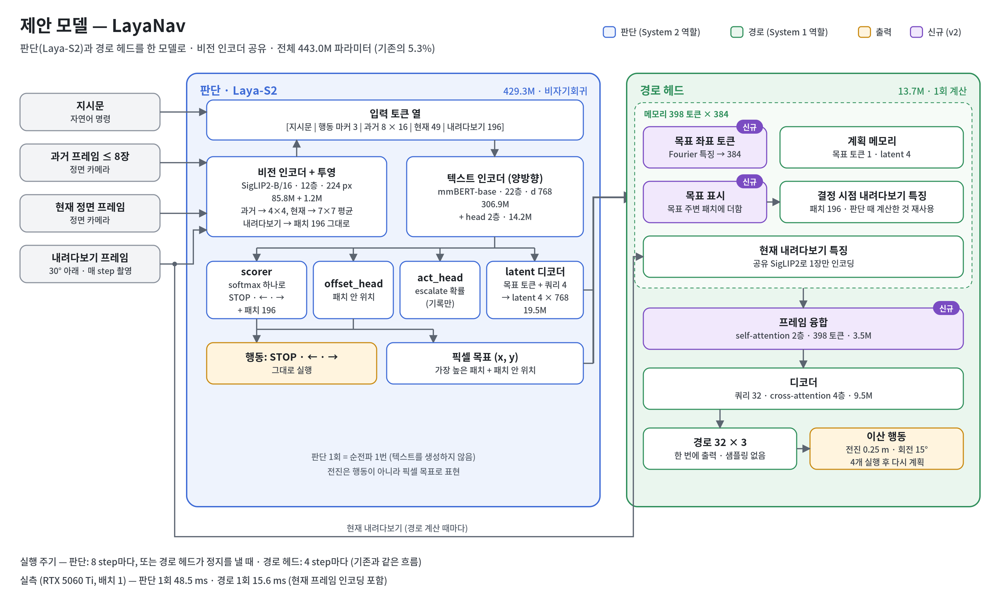
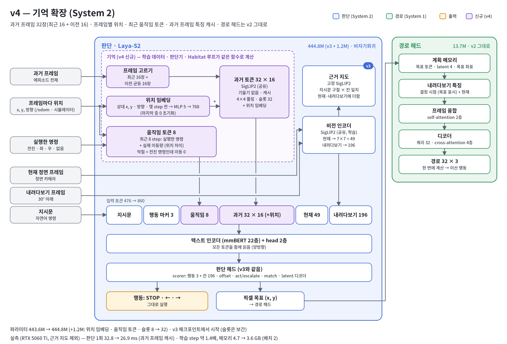

# LayaNav: Vision-and-Language Navigation with One Small Model

English | [한국어](README_ko.md)

LayaNav replaces the two systems of a dual-system VLN agent — a 7B vision-language model that decides where to
go (System 2) and a diffusion policy that turns the decision into a path (System 1) — with **a single 445M-parameter
model**. The decision is made by a non-autoregressive, Laya-style decision model that scores every option in one
forward pass: the actions STOP / turn left / turn right and the 196 floor patches of a 30°-down view, so *what to
do* and *where to go* are one choice. A small trajectory head reuses the decision's features and regresses the path
to the chosen point in one pass, without sampling.



> **Status (work in progress).** All results below are offline measurements on held-out scenes or simulator
> checks. Closed-loop R2R-CE / RxR-CE success rates (SR, SPL) are not measured yet.

## Highlights

| | Dual-system baseline (DualVLN) | LayaNav |
|---|---|---|
| Parameters | 8.38B (Qwen2.5-VL-7B + DiT) | **444.8M** (v4) |
| Decision | autoregressive text generation, several calls per goal | **one forward pass** over 3 actions + 196 floor patches |
| Path (one plan) | DiT, 10 denoising steps × batch 64, mean of 32 samples: **201.8 ms** | regression head, one pass: **10.8 ms** |
| Vision encoders | one per system | **one, shared** (SigLIP2-B/16) |

Times: RTX 3090, bf16, batch 1 (path head of v1; v2 is about 6% slower). The 7B decision time under the same
conditions is not measured yet.

## Model versions

Each improvement has its own document (diagnosis → change → cost → training → checks → results; in Korean).

| Version | Change | Main result so far | Document |
|---|---|---|---|
| v1 | Laya-S2 decision + trajectory head as one model | first trajectory head too weak | [report](docs/laya_nav/IMPLEMENTATION_REPORT.md) |
| v2 | trajectory head: frame fusion, goal marking, 4 start frames per sample; R2R + RxR + ScaleVLN | path error 0.09 m with the true goal (mean-trajectory baseline 0.52 m) | [v2_path_head.md](docs/laya_nav/model_improvement/v2_path_head.md) |
| v3 | instruction grounding: frozen SigLIP2 phrase-to-patch maps added to the decision tokens; instruction / view matching loss | held-out goal accuracy 43.2% (v2: 41.7%); sensitivity to the named object 2.4× (Isaac Sim) | [v3_grounding.md](docs/laya_nav/model_improvement/v3_grounding.md) |
| v4 | memory: 32 history frames (latest 16 + older 16) with their poses, tokens for the last 8 steps (command and measured move) | held-out goal accuracy 46.6% (v3: 43.2%); in Isaac Sim it copies its previous turn and keeps turning | [v4_memory.md](docs/laya_nav/model_improvement/v4_memory.md) |
| v5 | training against copying the previous action: memory inputs dropped for half of the samples, change points weighted 3×, left-right mirrored samples; shortcut checks in the diagnosis | not trained yet | [v5_copycat.md](docs/laya_nav/model_improvement/v5_copycat.md) |



Goal accuracy: share of goal decisions within 1.5 patches of the labelled goal, on 5,000 samples from scenes held
out from training (`scripts/train/laya_s2/diagnose_decision.py`).

## Where the code is

| Path | Content |
|---|---|
| `internnav/model/basemodel/laya_s2/` | the model (`laya_s2.py` decision, `laya_nav.py` trajectory head, `grounding.py`, `agent.py`) |
| `internnav/dataset/laya_s2_dataset.py` | training samples from InternData-N1 trajectories, history / memory features |
| `scripts/train/laya_s2/` | training (`train_laya_nav.py`, `train_laya_nav.sh`), diagnosis (`diagnose_decision.py`, `eval_traj.py`) |
| `internnav/habitat_extensions/vln/laya_s2_eval.py` | closed-loop Habitat evaluation loop |
| `tests/laya_s2/` | CPU tests with tiny encoders |

## Setup

```bash
bash scripts/setup/setup_laya_s2_server.sh env            # conda environment "laya" (Habitat + training)
conda activate laya
huggingface-cli login                                       # InternData-N1 / Scene-N1 are gated: accept their terms
DATASETS="r2r rxr scalevln" bash scripts/setup/setup_laya_s2_server.sh train_data
bash scripts/setup/setup_laya_s2_server.sh eval_data      # R2R VLN-CE episodes + MP3D scenes (closed loop)
bash scripts/setup/setup_laya_s2_server.sh ckpt           # dual-system baseline, only for the comparison
python -m pytest -q tests/laya_s2
```

Training data (compressed): r2r 334 GB, rxr 911 GB, ScaleVLN 1.3 TB. Archives are fetched, extracted and deleted one
at a time; rerun the same command after an interruption.

## Training

```bash
# v2 pipeline: trajectory head only (C1), then everything (C2), with a diagnosis after each stage
bash scripts/train/laya_s2/train_laya_nav.sh

# v5 from a v3 checkpoint (v4 = the same without the last line of options)
torchrun --nproc_per_node=1 scripts/train/laya_s2/train_laya_nav.py --stage c2 \
    --init_from checkpoints/laya_nav_v3_c2/step_48000 \
    --vln_dataset_use r2r_125cm_0_30,rxr_125cm_0_30,scalevln_125cm_0_30 \
    --grounding 1 --w_match 0.2 --lr_text 1e-5 --max_text_len 256 \
    --num_history 32 --hist_recent 16 --hist_pose 1 --motion_tokens 8 --hist_grad 0 \
    --mirror 0.5 --memory_dropout 0.5 --w_change 3 \
    --epochs 1 --batch_size 32 --output_dir checkpoints/laya_nav_v5_c2
```

Single GPU (H200), one epoch (2.05M samples): v3 13.7 h, v4 20.5 h.

## Evaluation

```bash
# offline: decision accuracy, STOP confusion, calibration, instruction truncation, shortcut checks (memory off,
# left / right swapped in the instruction, mirrored samples; --checks none to skip), several checkpoints at once
python scripts/train/laya_s2/diagnose_decision.py --vln_dataset_use r2r_125cm_0_30,rxr_125cm_0_30,scalevln_125cm_0_30 \
    --ckpts <ckpt> [<ckpt> ...] --out_dir logs/diagnosis/decision_val

# offline: trajectory error with the true goal and with the model's own goal
python scripts/train/laya_s2/eval_traj.py --ckpt <ckpt> --vln_dataset_use r2r_125cm_0_30 --own_goal

# closed loop in Habitat (VLN-CE), side by side with the dual-system baseline
LAYA_NAV=<ckpt> EVAL_EPISODES=300 bash scripts/eval/bash/compare_laya_s2.sh
```

## Acknowledgements and licenses

- Built on [InternNav](https://github.com/InternRobotics/InternNav) (MIT License, © 2025 Intern Robotics): data
  loading, the Habitat evaluation framework and the dual-system baseline. Its original README is kept in
  [README_InternNav.md](README_InternNav.md). LayaNav uses no weights of the baseline models.
- Training data: [InternData-N1](https://huggingface.co/datasets/InternRobotics/InternData-N1)
  (CC BY-NC-SA 4.0). Encoders: SigLIP2-B/16, mmBERT-base.
- This repository keeps the MIT License of InternNav ([LICENSE](LICENSE)).

## Citation

A citation will be added with the paper.
