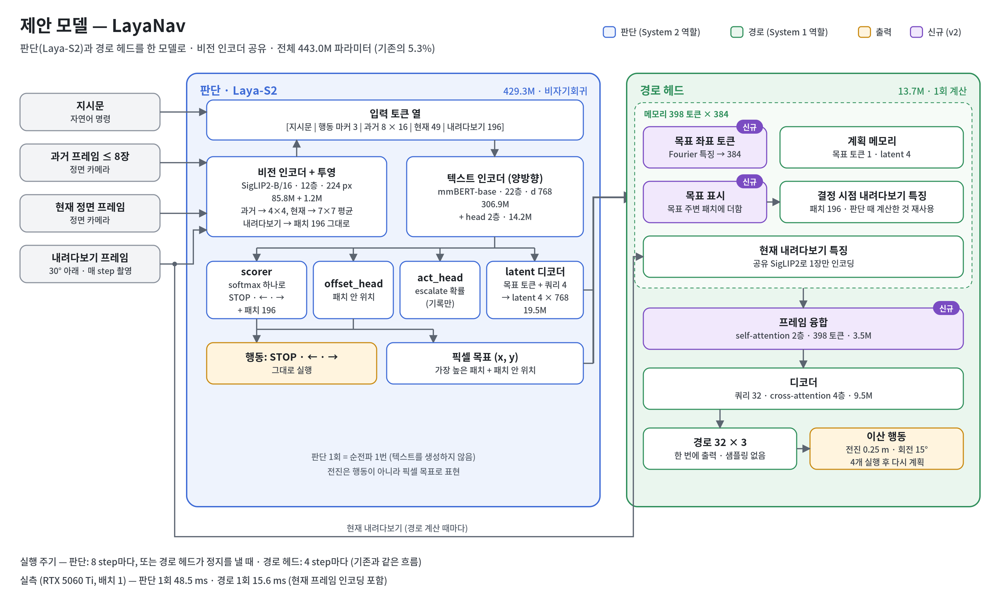
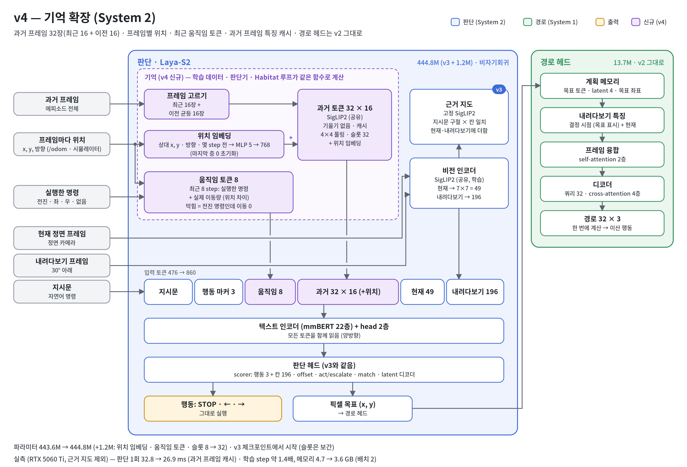

# LayaNav: 작은 모델 하나로 하는 시각-언어 내비게이션

[English](README.md) | 한국어

LayaNav는 듀얼 시스템 VLN 에이전트의 두 시스템을 **445M 파라미터 모델 하나**로 바꾼다.
- 기존 구조: 어디로 갈지 정하는 7B 비전-언어 모델(System 2) + 그 결정을 경로로 바꾸는 diffusion 정책(System 1)
- **판단**: 비자기회귀 Laya 방식 결정 모델이 순전파 한 번으로 모든 선택지에 점수를 매긴다. 선택지는 STOP·좌회전·우회전과 30° 아래를 본 화면의 바닥 칸 196개다. 그래서 *무엇을 할지*와 *어디로 갈지*를 한 번에 고른다.
- **경로**: 작은 경로 헤드가 판단 때 계산한 특징을 재사용해, 고른 지점까지의 경로를 샘플링 없이 한 번에 회귀한다.



> **현재 상태 (진행 중).** 아래 결과는 모두 학습에 쓰지 않은 장면에서의 오프라인 측정이거나 시뮬레이터 확인이다.
> R2R-CE / RxR-CE 폐루프 성공률(SR, SPL)은 아직 측정하지 않았다.

## 핵심 비교

| | 듀얼 시스템 기준 모델 (DualVLN) | LayaNav |
|---|---|---|
| 파라미터 | 8.38B (Qwen2.5-VL-7B + DiT) | **444.8M** (v4) |
| 판단 | 자기회귀 텍스트 생성, 목표 하나에 여러 번 호출 | 행동 3개 + 바닥 칸 196개에 대한 **순전파 1번** |
| 경로 (계획 1회) | DiT 잡음 제거 10단계 × 배치 64, 샘플 32개 평균: **201.8 ms** | 회귀 헤드 1번: **10.8 ms** |
| 비전 인코더 | 시스템마다 따로 | **하나를 공유** (SigLIP2-B/16) |

측정 조건은 RTX 3090, bf16, 배치 1이고 경로 헤드는 v1 기준이다(v2는 약 6% 느림). 같은 조건의 7B 판단 시간은 아직 측정하지 않았다.

## 모델 버전

개선마다 문서를 하나씩 둔다. 순서는 진단 → 변경 → 비용 → 학습 → 확인 → 결과다.

| 버전 | 변경 | 지금까지의 주요 결과 | 문서 |
|---|---|---|---|
| v1 | Laya-S2 판단 + 경로 헤드를 한 모델로 | 첫 경로 헤드가 약함 | [구현 보고서](docs/laya_nav/IMPLEMENTATION_REPORT.md) |
| v2 | 경로 헤드: 프레임 융합, 목표 표시, 샘플당 출발 지점 4개. R2R + RxR + ScaleVLN | 정답 목표 기준 경로 오차 0.09 m (평균 궤적 기준선 0.52 m) | [v2_path_head.md](docs/laya_nav/model_improvement/v2_path_head.md) |
| v3 | 지시문 근거 연결: 고정 SigLIP2의 구절–칸 일치 지도를 판단 토큰에 더함. 지시문–화면 짝 맞추기 손실 | 처음 보는 장면 목표 정확도 43.2% (v2: 41.7%). 지시한 물체에 대한 반응 2.4배 (Isaac Sim) | [v3_grounding.md](docs/laya_nav/model_improvement/v3_grounding.md) |
| v4 | 기억: 과거 프레임 32장(최근 16 + 이전 16)과 각 프레임의 위치, 최근 8 step의 명령과 실제 이동량 토큰 | 처음 보는 장면 목표 정확도 46.6% (v3: 43.2%). Isaac Sim에서는 직전 회전을 베껴 계속 돎 | [v4_memory.md](docs/laya_nav/model_improvement/v4_memory.md) |
| v5 | 학습: 직전 행동 베끼기 막기. 샘플 절반에서 기억 입력 지우기, 전환 시점 손실 3배, 좌우 반전 샘플. 진단에 지름길 지표 추가 | 학습 전 | [v5_copycat.md](docs/laya_nav/model_improvement/v5_copycat.md) |



목표 정확도는 학습에서 뺀 장면의 5,000샘플에서 목표 판단이 정답 목표로부터 1.5칸 안에 든 비율이다(`scripts/train/laya_s2/diagnose_decision.py`).

## 코드 위치

| 경로 | 내용 |
|---|---|
| `internnav/model/basemodel/laya_s2/` | 모델 (`laya_s2.py` 판단, `laya_nav.py` 경로 헤드, `grounding.py`, `agent.py`) |
| `internnav/dataset/laya_s2_dataset.py` | InternData-N1 궤적에서 만드는 학습 샘플, 과거 프레임과 기억 입력 |
| `scripts/train/laya_s2/` | 학습 (`train_laya_nav.py`, `train_laya_nav.sh`), 진단 (`diagnose_decision.py`, `eval_traj.py`) |
| `internnav/habitat_extensions/vln/laya_s2_eval.py` | Habitat 폐루프 평가 루프 |
| `tests/laya_s2/` | 작은 인코더로 도는 CPU 테스트 |

## 설치

```bash
bash scripts/setup/setup_laya_s2_server.sh env            # conda 환경 "laya" (Habitat + 학습)
conda activate laya
huggingface-cli login                                       # InternData-N1 / Scene-N1은 약관 동의가 필요
DATASETS="r2r rxr scalevln" bash scripts/setup/setup_laya_s2_server.sh train_data
bash scripts/setup/setup_laya_s2_server.sh eval_data      # R2R VLN-CE 에피소드 + MP3D 장면 (폐루프 평가용)
bash scripts/setup/setup_laya_s2_server.sh ckpt           # 듀얼 시스템 기준 모델 (비교용)
python -m pytest -q tests/laya_s2
```

학습 데이터의 압축 크기는 r2r 334 GB, rxr 911 GB, ScaleVLN 1.3 TB다. 압축 파일을 하나씩 받아 풀고 지운다. 중간에 끊기면 같은 명령을 다시 실행하면 이어서 받는다.

## 학습

```bash
# v2 과정: 경로 헤드만(C1) → 전체(C2), 단계마다 진단 포함
bash scripts/train/laya_s2/train_laya_nav.sh

# v3 체크포인트에서 v5 학습 (v4는 마지막 옵션 줄만 뺀 것)
torchrun --nproc_per_node=1 scripts/train/laya_s2/train_laya_nav.py --stage c2 \
    --init_from checkpoints/laya_nav_v3_c2/step_48000 \
    --vln_dataset_use r2r_125cm_0_30,rxr_125cm_0_30,scalevln_125cm_0_30 \
    --grounding 1 --w_match 0.2 --lr_text 1e-5 --max_text_len 256 \
    --num_history 32 --hist_recent 16 --hist_pose 1 --motion_tokens 8 --hist_grad 0 \
    --mirror 0.5 --memory_dropout 0.5 --w_change 3 \
    --epochs 1 --batch_size 32 --output_dir checkpoints/laya_nav_v5_c2
```

GPU 1장(H200) 기준 1 epoch(205만 샘플)에 v3는 13.7시간, v4는 20.5시간이 걸렸다.

## 평가

```bash
# 오프라인: 판단 정확도, STOP 혼동표, 확률 보정, 지시문 잘림, 지름길 지표(기억 끄기, 지시문 좌우 바꾸기, 좌우 반전.
# --checks none이면 생략). 체크포인트 여러 개를 한 번에
python scripts/train/laya_s2/diagnose_decision.py --vln_dataset_use r2r_125cm_0_30,rxr_125cm_0_30,scalevln_125cm_0_30 \
    --ckpts <ckpt> [<ckpt> ...] --out_dir logs/diagnosis/decision_val

# 오프라인: 정답 목표 / 모델이 고른 목표 기준 경로 오차
python scripts/train/laya_s2/eval_traj.py --ckpt <ckpt> --vln_dataset_use r2r_125cm_0_30 --own_goal

# Habitat 폐루프 (VLN-CE), 듀얼 시스템 기준 모델과 나란히
LAYA_NAV=<ckpt> EVAL_EPISODES=300 bash scripts/eval/bash/compare_laya_s2.sh
```

## 감사의 말과 라이선스

- [InternNav](https://github.com/InternRobotics/InternNav)(MIT License, © 2025 Intern Robotics)를 바탕으로 만들었다.
  - 가져다 쓴 것: 데이터 로딩, Habitat 평가 틀, 듀얼 시스템 기준 모델
  - 원래 README는 [README_InternNav.md](README_InternNav.md)에 남겨 두었다.
  - LayaNav는 기준 모델의 가중치를 쓰지 않는다.
- 학습 데이터는 [InternData-N1](https://huggingface.co/datasets/InternRobotics/InternData-N1)(CC BY-NC-SA 4.0)이다. 인코더는 SigLIP2-B/16과 mmBERT-base를 쓴다.
- 이 저장소는 InternNav의 MIT License를 따른다([LICENSE](LICENSE)).

## 인용

논문과 함께 추가할 예정이다.
