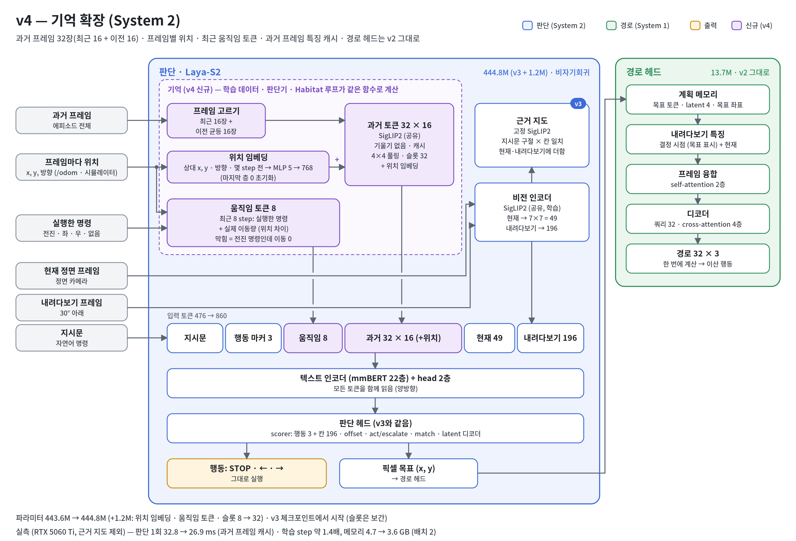

# v4: 기억 확장 (과거 프레임 32장 + 위치 + 최근 움직임)

> **대상: System 2 (판단 모델 Laya-S2).** 경로 헤드(System 1)는 바꾸지 않았다.

## 진단

**Isaac KIMM 주행 (2026-10-30, v3 `step_64000`)**

| 관찰 | 근거 |
|---|---|
| 목표 물체가 화면에 없으면 찾으러 가지 못한다 | 같은 지시문("Walk to the air conditioner and stop.")으로 3번 주행해 3번 모두 다른 곳에서 멈췄다. 에어컨은 지나간 화면에 한 번도 보이지 않았다 |
| 엉뚱한 곳에서 확신 있게 멈춘다 | 빈 벽 모서리 앞에서 STOP 확률 0.94 |
| 막혀도 알아채지 못한다 | 2026-10-10 주행: 의자에 걸린 뒤 같은 경로(2.95 m)를 3번 반복 |

**구조상 원인**
- **최근 기억이 빠진다**: 과거 프레임 8장을 에피소드 전체에서 균등하게 뽑는다. 주행이 길어질수록 방금 지나온 몇 걸음이 빠진다.
- **위치를 모른다**: 각 프레임을 어디서 어느 방향으로 봤는지 모른다. 그래서 "왼쪽은 이미 봤다", "여긴 왔던 곳"을 판단할 수 없다.
- **움직였는지 모른다**: 입력에 실제 이동량이 없어서, 막혔다는 사실 자체를 알 수 없다.

## 변경



보라색이 v4에서 더한 부분이다. 근거 지도(v3)와 판단 헤드, 경로 헤드는 바꾸지 않았다.

**입력 토큰 열**

`[지시문 | 행동 마커 3 | 최근 움직임 8 | 과거 프레임 32 × 16 (+ 위치) | 현재 49 | 내려다보기 196]`

| 항목 | v3 | v4 | 인자 |
|---|---|---|---|
| 과거 프레임 | 8장, 에피소드 전체에서 균등 | 32장: 최근 16장 + 그 이전에서 균등 16장 | `--num_history 32 --hist_recent 16` |
| 프레임별 위치 | 없음 | 현재 위치 기준 상대 위치(x, y), 방향(sin, cos), 경과 step → MLP(5 → 768)로 각 프레임 토큰에 더함. 마지막 층은 0으로 초기화 | `--hist_pose 1` |
| 최근 움직임 | 없음 | 최근 8 step마다 토큰 1개: 행동(STOP/전진/좌/우/없음) 임베딩 + 실제 이동량(전진·좌우 0.25 m, 회전 15° 단위) MLP | `--motion_tokens 8` |
| 과거 프레임 학습 | 기울기 있음 | 기울기 없이 인코딩. 이미지 인코더는 현재·내려다보기 화면으로 계속 학습 | `--hist_grad 0` |
| 추론 | 판단마다 과거 프레임 전체를 다시 인코딩 | 판단기(agent)가 프레임 특징을 에피소드 안에서 캐시 | – |

- **v3 체크포인트에서 시작**
  - 과거 프레임 순서 임베딩(슬롯)은 8개에서 32개로 보간한다(오래된 쪽 → 최근 쪽 순서 유지).
  - 위치·움직임 모듈은 새로 추가한다. 파라미터는 443.6M에서 444.8M로 1.2M 늘어난다.
  - 과거 프레임 구성이 바뀌므로 첫 출력이 v3와 완전히 같지는 않다.
- **학습과 추론의 일치**
  - 데이터셋, 판단기(agent), Habitat 평가 루프가 같은 함수(`history_ids`, `memory_features`)로 프레임을 고르고 위치를 계산한다.
  - 위치 규칙은 x 앞, y 왼쪽, 반시계 방향이 +다. Habitat 시뮬레이터에서 전진 = (1, 0, 0), 좌회전 = 방향 +로 같은 규칙인 것을 확인했다.
- **기존 체크포인트**: 새 설정은 모두 기본값이 꺼짐이라 v1~v3는 전과 같이 동작한다.

## 비용 (RTX 5060 Ti 단독, bf16, 실제 크기 인코더, 지시문 100토큰, 근거 지도 제외)

| 과거 프레임 | 토큰 | 판단 1회 (지금 방식) | 판단 1회 (프레임 캐시) | 학습 step, 배치 2 (전체 기울기) | 학습 step, 배치 2 (과거 프레임 기울기 없이) |
|---|---|---|---|---|---|
| 8 (v3) | 476 | 32.8 ms | 25.9 ms | 132 ms, 4.7 GB | 94 ms, 3.4 GB |
| **32 (v4)** | **860** | 65.5 ms | **26.9 ms** | 354 ms, 8.5 GB | **190 ms, 3.6 GB** |
| 64 | 1,372 | 120.3 ms | 37.7 ms | 670 ms, 13.9 GB | 341 ms, 4.5 GB |

- **비용은 거의 전부 이미지 인코딩이다.** 토큰을 476개에서 860개로 늘려도 판단 모델(mmBERT)은 1 ms만 늘어난다.
- **v4 설정**
  - 판단: v3와 거의 같다.
  - 학습 step: v3의 약 1.4배.
  - 메모리: 오히려 줄어든다.
- **샘플마다 읽는 이미지**가 10장에서 34장으로 늘어서, 서버에서는 데이터 로딩이 먼저 병목이 될 수 있다.
- 측정 스크립트: `laya_work/time_history_tokens.py`

## 학습 (서버)

v3에서 검증 목표 정확도가 가장 높았던 `step_48000`에서 이어서 학습한다.

```bash
git pull
python scripts/train/laya_s2/train_laya_nav.py --stage c2 --init_from checkpoints/laya_nav_v3_c2/step_48000 \
    --vln_dataset_use r2r_125cm_0_30,rxr_125cm_0_30,scalevln_125cm_0_30 \
    --grounding 1 --w_match 0.2 --lr_text 1e-5 \
    --num_history 32 --hist_recent 16 --hist_pose 1 --motion_tokens 8 --hist_grad 0 \
    --epochs 1 --batch_size 32 --num_workers 16 --output_dir checkpoints/laya_nav_v4_c2
```

- **로그 확인**: 시작 로그에 `memory: 32 history frames (16 latest) | pose=True | motion tokens=8 | history gradients=False`가 나와야 한다.
- **검증 지표**: STOP을 한 번씩만 센다(`--val_stop_repeat 1`, 기본값). v3와 비교하려면 v3 체크포인트를 `diagnose_decision.py`로 같은 조건에서 함께 잰다.
- **속도**: 데이터 로딩이 느리면 `--num_workers`를 늘린다.

## 확인

| 확인 | 방법 | 기대 |
|---|---|---|
| 목표 선택 | 검증 `acc_goal`, `acc_stop`, `acc_turn`; `diagnose_decision.py`로 v3와 비교 | v3보다 높음. 특히 경로가 긴 RxR |
| 반복·맴돌기 | Isaac KIMM 주행 | 같은 곳을 맴도는 횟수가 줄어듦 |
| 추론 시간 | 판단기 캐시 | 판단 1회가 v3 수준 |

## 한계

- **기억만으로는 회복·탐색 행동이 생기지 않는다.** 전문가 경로 데이터에는 막히는 순간과 탐색이 없다. 움직임 토큰이 있어도 "막혔을 때 무엇을 할지"는 그런 상황이 담긴 데이터(HA-VLN-CE DAgger, 물체 목표 데이터)로 배워야 한다([다음 후보](next_candidates.md)).
- **직전 행동을 베끼는 지름길이 생겼다.** 위치·움직임 입력이 직전 행동을 알려 주고, 전문가 경로에서는 직전 행동이 정답을 거의 알려 준다. 결과 절과 [v5](v5_copycat.md)를 참고한다.
- **Isaac**: 클라이언트가 `/odom` 위치와 실행한 명령을 보내고, 0.25 m마다 지나간 화면을 기록에 더한다(학습 프레임 간격과 같음, `laya_work/isaac`).

## 결과

`laya_nav_v4_c2`: v3 `step_48000`에서 64,213 step(20.5시간, batch 32) 더 학습했다. 수치 기록은 [결과 노트](../results/laya_nav_v4_c2.md)에 있다.

**검증 정확도 (%)**: 처음 보는 집 5,000샘플, STOP은 1번씩 센다. 샘플은 `diagnose_decision.py`와 같다.

| 지표 | v3 `step_48000` | v4 `step_48000` | v4 `step_64000` |
|---|---|---|---|
| 목표 | 43.2 | **46.6** | 45.5 |
| 회전 | 63.8 | 66.4 | **68.7** |
| STOP | **68.9** | 64.9 | 63.3 |
| 전체 | 49.6 | **52.3** | 52.0 |

v3 값은 진단 스크립트로, v4 값은 학습 중 검증으로 쟀다.

**Isaac KIMM** (화면 8장, `siglip_check.py`, `ambiguity_check.py`)

| 체크포인트 | 물체만 바꿀 때 TVD | 물체와 상관없이 같은 행동인 화면 | 모호한 지시문이 맞는 목표에 가까운 비율 (우연 0.2) |
|---|---|---|---|
| v3 `step_64000` | 0.041 | 4 / 8 | – |
| v4 `step_48000` | 0.059 | 8 / 8 | 0.23 |
| v4 `step_64000` | 0.045 | 7 / 8 | 0.20 |

- **주행**: 같은 출발 위치에서 지시문 5개로 주행했다. 5번 모두 지시문과 관계없이 처음 8번을 우회전했다.
- **원인**: 직전 행동 베끼기. 저장 화면 시험에서 같은 방향으로 8번 돈 기록을 주면, 반대 방향 확률이 16/16 경우에서 0이었다. 회전 뒤 목표로 출발할 확률은 0.32–0.35로 v3(0.71–0.74)의 절반이다. 자세한 내용은 [v5 진단](v5_copycat.md)에 있다.

**해석**
- **오프라인 지표는 좋아졌다.** 목표 +3.4%p, 회전 +2.6%p이고, STOP은 4.0%p 떨어졌다.
- **향상의 출처는 아직 모른다.**
  - 전문가 경로 검증에서는 직전 행동을 베껴도 점수가 오른다.
  - v4는 v3에서 1 epoch 더 학습한 것이기도 하다.
  - 기억 덕인지, 지름길 덕인지, 추가 학습 덕인지는 v5 진단(`memory_off`, 전환 정확도)으로 가른다.
- **주행은 오히려 나빠졌다.** 계속 도는 쪽으로 기울었다.

**구현 확인 (학습 전, 이 PC)**
- 테스트 38개 통과
- v3 체크포인트에 v4 설정으로 2 step 학습
- Habitat 미니 시뮬레이션 4개 에피소드: 판단 81번 모두 위치·행동을 받았고 프레임 캐시가 동작함
